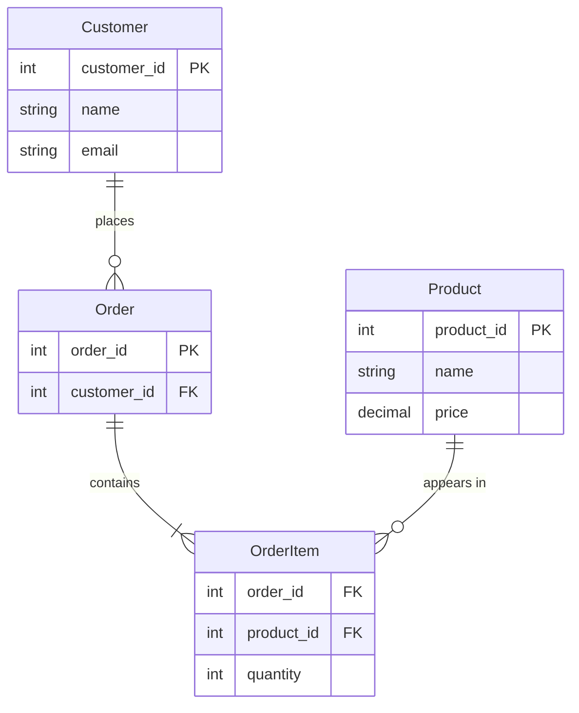
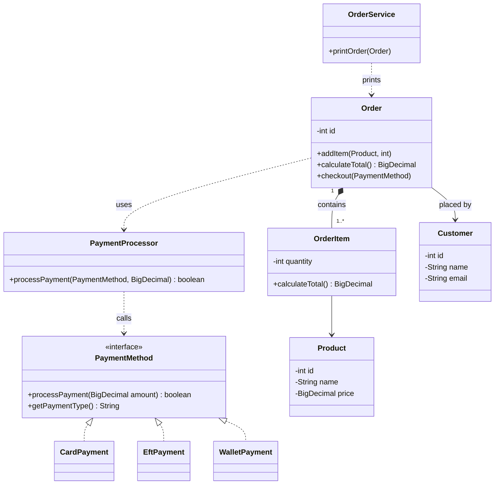

# PayNest: Merchant Order Desk and Unified Checkout

## Overview

PayNest is a lightweight commerce kernel built in plain Java 21 (no frameworks). It manages customers, products and orders, and lets an order be paid through any supported payment rail (card, EFT or wallet) using one checkout flow. The design separates concerns: domain classes hold data and business rules, the service layer handles presentation and formatting, and the payment package hides rail-specific behaviour behind a single interface.

## Project Structure

```
<repository root>/
├── README.md
├── .gitignore
├── Diagram/                 design diagrams (ClassDiagram.pdf)
└── Project_root/
    ├── pom.xml
    └── src/
        ├── main/java/com/paynestsystem/
        │   ├── app/         PaynestApplication (demo entry point)
        │   ├── domain/      Customer, Product, Order, OrderItem
        │   ├── service/     OrderService (prints the order summary)
        │   └── payment/     PaymentMethod, CardPayment, EftPayment,
        │                    WalletPayment, PaymentProcessor
        └── test/java/com/paynestsystem/
            ├── domain/      OrderCheckoutTest, OrderItemTest,
            │                OrderTest, ProductTest
            └── payment/     PaymentMethodTest
```

| Package | Description |
|---------|-------------|
| app | Contains the application entry point. |
| domain | Contains the core business entities: Customer, Product, Order and OrderItem. |
| service | Contains presentation logic, such as printing the order summary. |
| payment | Contains the `PaymentMethod` interface, its rail implementations and the `PaymentProcessor`. |

## Features

- Create customers and products
- Create orders and add items (quantities must be greater than 0)
- Calculate the order total from its line items
- Print a readable order summary
- Check out with any payment rail through the `PaymentMethod` interface
- Reject invalid input (null or empty values, empty orders, null payment methods)

## Technologies Used

- Java 21
- Maven
- JUnit 5
- VS Code

## Prerequisites

Before running the project, make sure you have:

- Java 21 or later (JDK)
- Maven 3.9 or later
- Git

## Getting Started

### Clone the repository

In a terminal or bash window:

```bash
git clone https://github.com/Umuzi-skillslab/merchant-order-desk-and-catalogue-engine-mmasellomanabile-umuzi.git
cd merchant-order-desk-and-catalogue-engine-mmasellomanabile-umuzi
cd Project_root
```

The `Project_root` folder is the one that contains `pom.xml`. Run all of the commands below from there.

## Running the Application

### Option 1: Run from the terminal

1. Compile the project:

```bash
mvn clean compile
```

2. Run the application:

```bash
mvn exec:java
```

### Option 2: Run from VS Code

Open `PaynestApplication.java` and click the Run button. The output appears in the terminal.

### Expected Output

```
Order Summary:
*********************************
Customer: Maxine Ramokgopa
Headsets x2 = R2000.00
Keyboard x4 = R1200.00
****************************************
Your total is: R3200.00
****************************************
Thank you for choosing us Maxine Ramokgopa
****************************************
Processing card payment for R3200.00
Payment successful via CARD
Amount: R3200.00
Order completed successfully.
```

Please note: amounts use your system's regional settings for the decimal separator, so on a South African locale you will see `R3200,00` instead of `R3200.00`. This is expected.

## Tests

Run this from `Project_root`:

```bash
mvn test
```

Expected result: `BUILD SUCCESS` with no failures or errors. The tests cover:

- line and order totals, invalid quantities and null products
- product and customer validation, and price rounding
- every payment rail through the `PaymentMethod` interface
- checkout charging exactly the order total (using a custom test rail)
- failed payments, null payment methods, empty orders and the read-only item list

## How Checkout Works

`Order.checkout(PaymentMethod)` calculates the order total once and passes it to `PaymentProcessor`, which calls `processPayment(amount)` on whichever rail it was given and prints the result. To switch rails, change only the line in `PaynestApplication` that creates the payment method: `new CardPayment()`, `new EftPayment()` or `new WalletPayment()`.

## Core Design

PayNest is designed with extensibility and maintainability in mind.

### Encapsulation

Each `OrderItem` calculates its own subtotal and the `Order` adds those up, so the calculation logic stays close to the data it belongs to.

### Separation of concerns

- Domain layer: business rules and data models
- Service layer: formatting and presentation
- Payment package: rail-specific behaviour behind one interface

This keeps the core clean and avoids mixing responsibilities.

### Why an interface and not one mega-method

A single payment method full of `if (card) ... else if (eft) ...` branches has to be edited every time a rail is added, and each edit risks breaking rails that already work. With the `PaymentMethod` interface, `Order` and `PaymentProcessor` depend only on the contract "process this amount", and each rail owns its own label and message. Adding a `BuyNowPayLaterPayment` rail would mean writing one new class and changing one line in the demo. The order total calculation is never touched.

### Extensibility

A `Product` holds catalogue information such as its ID, name and price. An `OrderItem` combines a product with a quantity and calculates its line subtotal. The `Order` calculates the grand total by summing the subtotals of its items.

Because the order calculation depends on the product's price rather than on individual catalogue fields, new product information such as SKU, description, category or stock can be added to `Product` without rewriting the checkout calculation. The service layer generates the human-readable order summary, keeping presentation separate from the domain model.

### Future scalability

The current design makes it straightforward to add features such as:

- Discounts
- Taxes
- Shipping costs
- Promotions
- Additional reporting services

These can be introduced through new classes or services without changing the existing order-processing logic.

### Money handling

Prices are rounded to 2 decimal places (`RoundingMode.HALF_UP`) when a `Product` is created, so every line total and the grand total reconcile exactly. The brief's starter code used `double`; `BigDecimal` is used instead, as required by the assessors.

## Known Limitations

- A product with a price of 0 is allowed, but an order whose total is 0 cannot be checked out, because `PaymentProcessor` rejects amounts that are not greater than 0.
- Checkout does not mark an order as paid, so calling `checkout` twice charges twice. Order status is out of scope for these capstones.

## System Design

The class diagram is also available as a PDF in the `Diagram` folder: [ClassDiagram.pdf](Diagram/ClassDiagram.pdf).

### Data model



### Class diagram



## Author

Mmasello Manabile