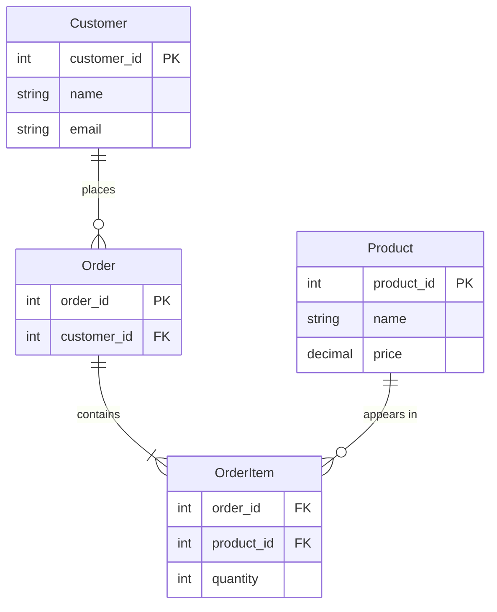
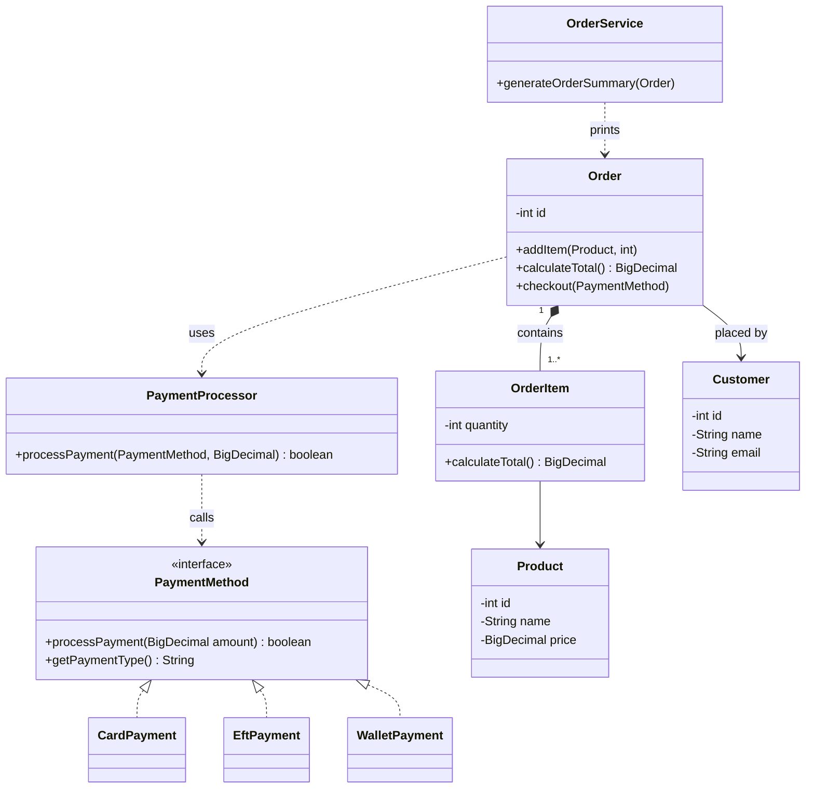

# PayNest: Merchant Order Desk and Unified Checkout

## Overview

PayNest is a lightweight commerce kernel built in plain Java 21 (no frameworks). It manages customers, products and orders, and lets an order be paid through any supported payment rail (card, EFT or wallet) using one checkout flow. The design separates concerns: domain classes hold data and business rules, the service layer handles presentation and formatting, and the payment package hides rail-specific behaviour behind a single interface.

## Project Structure

```
merchant-order-desk-and-catalogue-engine-mmasellomanabile-umuzi/
├── README.md
├── .gitignore
├── Diagram/ ClassDiagram.pdf
└── Project_root/
    ├── pom.xml
    └── src/
        ├── main/java/com/paynestsystem/
        │   ├── app/         PaynestApplication (demo entry point)
        │   ├── domain/      Customer, Product, Order, OrderItem
        │   ├── service/     OrderService (generates formatted order summaries)
        │   └── payment/     PaymentMethod, CardPayment, EftPayment, MoneyFormat, WalletPayment,        PaymentProcessor
        │            
        └── test/java/com/paynestsystem/
                ├── domain/
                    ├── CustomerTest
                │   ├── OrderCheckoutTest
                │   ├── OrderItemTest
                │   ├── OrderTest
                │   └── ProductTest
                ├── payment/
                │   └── PaymentMethodTest
                └── service/
                    └── OrderServiceTest
```

| Package | Description |
|---------|-------------|
| app | Contains the application entry point. |
| domain | Contains the core business entities: Customer, Product, Order and OrderItem. |
| service | Contains presentation logic, such as generating formatted order summaries. |
| payment | Contains the `PaymentMethod` interface, its rail implementations and the `PaymentProcessor`. |


## Features

- Create customers and products
- Create orders and add items (quantities must be greater than 0)
- Calculate the order total from its line items
- Print a readable order summary
- Check out with any supported payment rail through the `PaymentMethod` interface
- Support card, EFT and wallet payments
- Simulate successful and failed payment transactions
- Validate payment amounts and reject null, zero or negative values
- Handle payment failures and display appropriate feedback
- Reject invalid input (null or empty values, empty orders, null payment methods)

## Technologies Used

- Java 21
- Maven
- JUnit 5
- VS Code

## Prerequisites

Before running the project, make sure you have:

- Java 21 or later (JDK)
- Maven 3.9 or later
- Git

## Getting Started

### Clone the repository

In a terminal or bash window:

```bash
git clone https://github.com/Umuzi-skillslab/merchant-order-desk-and-catalogue-engine-mmasellomanabile-umuzi.git
cd merchant-order-desk-and-catalogue-engine-mmasellomanabile-umuzi
cd Project_root
```

## Running the Application

### Option 1: Run from the terminal

1. Compile the project:

```bash
mvn clean compile
```

2. Run the application:

```bash
mvn exec:java
```

### Option 2: Run from VS Code

Open `PaynestApplication.java` and click the Run button. The output appears in the terminal.

### Expected Output

```
Order Summary:
*********************************
Order: #1
Customer: Maxine Ramokgopa
Headsets x2 = R2,000.00
Keyboard x4 = R1,200.00
*********************************
Grand Total: R3,200.00
*********************************
Thank you for choosing us, Maxine Ramokgopa
*********************************
Processing wallet payment for R3200.00
Payment successful via WALLET
Amount: R3200.00
Order completed successfully.
```

The order summary uses US-style formatting (comma thousands separator), while the payment messages print the plain amount to two decimal places. Neither depends on the system locale.

**Example: Failed Card Payment** (`new CardPayment(true)`)

```
Card payment declined.
Payment failed via CARD
Please try again or select another payment method.
Order checkout failed.
```

**Example: Order with a total of zero**

```
Order checkout failed: order total must be greater than zero.
```

## Tests

Run this from `Project_root`:

```bash
mvn clean test
```


# What the tests cover:

- Line and order totals, invalid quantities and null products
- Product and customer validation, and price rounding
- Every payment rail through the PaymentMethod interface
- Checkout charging exactly the order total (using a custom test rail)
- Successful payments through card, EFT and wallet
- Declined payments through card, EFT and wallet: checkout reports failure and never says the order completed
- Zero-total orders: checkout fails clearly and the payment rail is never called
- Invalid payment amounts (null, zero, negative) and null payment methods
- Empty orders and the read-only item list.

## How Checkout Works

## How Checkout Works

`Order.checkout(PaymentMethod)` calculates the order total once. If the total is zero, it prints a failure message and stops, so the payment rail is never called. Otherwise it passes the total to `PaymentProcessor`.

`PaymentProcessor` is the single place that validates the payment method and the amount (not null, greater than zero). It then calls `processPayment(amount)` on whichever rail it receives and prints the result.

Each rail only handles its own behaviour: its messages, its label and its simulated outcome. It returns `true` for success or `false` for failure. Because the processor has already validated the amount, the rails do not repeat that check. A small package-private helper, `MoneyFormat`, formats amounts for all payment messages.

Card, EFT and wallet payments support simulated success and failure scenarios. The default constructors simulate successful transactions, while passing `true` to a payment constructor simulates a failed transaction.

To switch payment rails, change only the line in `PaynestApplication` that creates the payment method: `new CardPayment()`, `new EftPayment()` or `new WalletPayment()`.

## Core Design

PayNest is designed with extensibility and maintainability in mind.

### Encapsulation

Each `OrderItem` calculates its own subtotal and the `Order` adds those up, so the calculation logic stays close to the data it belongs to.

### Separation of concerns

- Domain layer: business rules and data models
- Service layer: formatting and presentation
- Payment package: rail-specific behaviour behind one interface

This keeps the core clean and avoids mixing responsibilities.

### Why an interface and not one mega-method

A single payment method full of `if (card) ... else if (eft) ...` branches has to be edited every time a rail is added, and each edit risks breaking rails that already work. With the `PaymentMethod` interface, `Order` and `PaymentProcessor` depend only on the contract "process this amount", and each rail owns its own label and message. Adding a `BuyNowPayLaterPayment` rail would mean writing one new class and changing one line in the demo. The order total calculation is never touched.

### Extensibility

A `Product` holds catalogue information such as its ID, name and price. An `OrderItem` combines a product with a quantity and calculates its line subtotal. The `Order` calculates the grand total by summing the subtotals of its items.

Because the order calculation depends on the product's price rather than on individual catalogue fields, new product information such as SKU, description, category or stock can be added to `Product` without rewriting the checkout calculation. The service layer generates the human-readable order summary, keeping presentation separate from the domain model.

### Future scalability

The current design makes it straightforward to add features such as:

- Discounts
- Taxes
- Shipping costs
- Promotions
- Additional reporting services

These can be introduced through new classes or services without changing the existing order-processing logic.

### Money handling

The brief's starter code used `double`. I chose `BigDecimal` instead because binary floating-point cannot represent amounts like 0.10 exactly, and rounding errors would show up in line totals and the grand total.

## Known Limitations

- A product with a price of 0 is allowed. An order whose total is 0 cannot be paid: `Order.checkout` reports "Order checkout failed" and does not call any payment rail.

- Checkout does not mark an order as paid, so calling `checkout` twice charges twice. Order status is out of scope for these capstones.

## System Design

The class diagram is also available as a PDF in the `Diagram` folder: [ClassDiagram.pdf](Diagram/ClassDiagram.pdf).

### Data model



### Class diagram



## Author

Mmasello Manabile