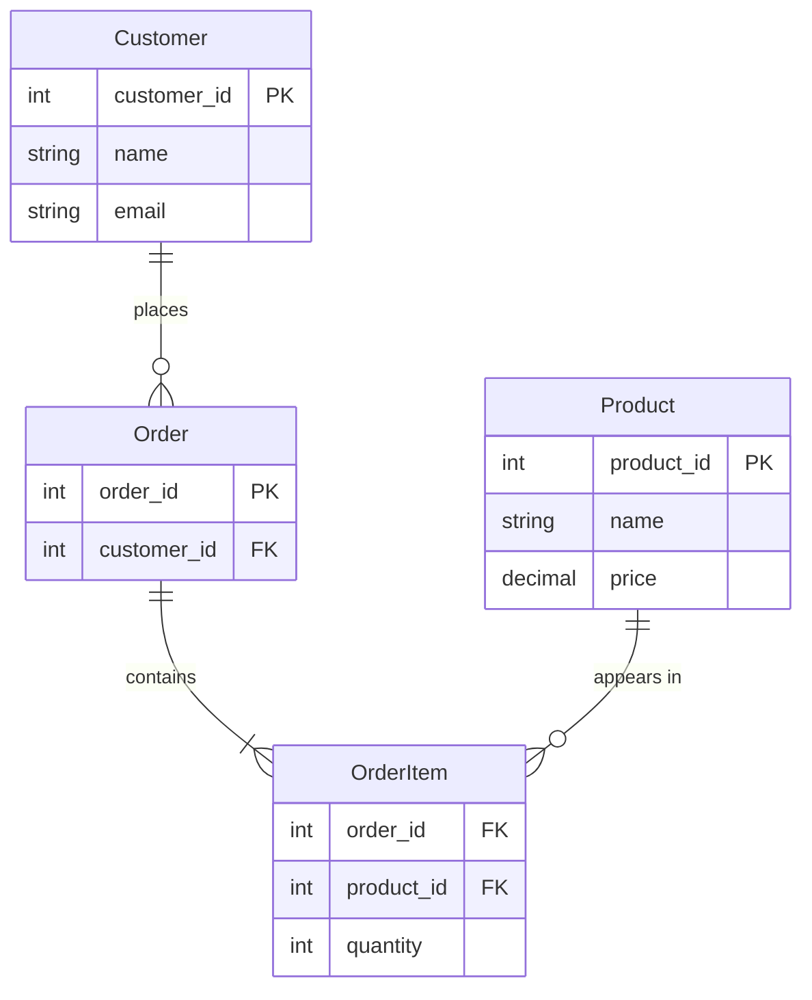
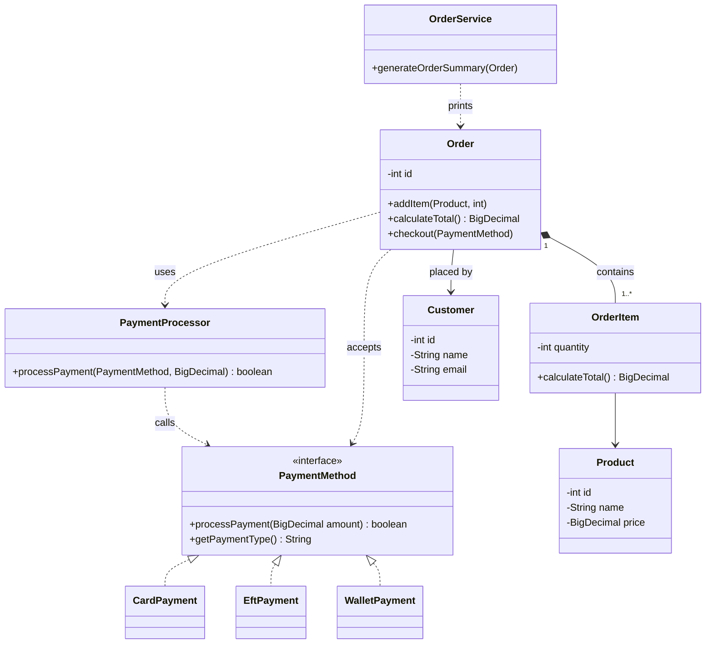

# PayNest: Merchant Order Desk and Unified Checkout

## Overview

PayNest is a lightweight commerce kernel built in plain Java 21 (no frameworks). This repository contains **Capstone 1** (Merchant Order Desk and Catalogue Engine) and **Capstone 3** (Unified Checkout Across Payment Rails).

It manages customers, products and orders, and lets an order be paid through any supported payment rail (card, EFT or wallet) using one checkout flow. The design separates concerns: domain classes hold data and business rules, the service layer handles presentation and formatting, and the payment package hides rail-specific behaviour behind a single interface.

## Project Structure

```
merchant-order-desk-and-catalogue-engine-mmasellomanabile-umuzi/
├── README.md
├── .gitignore
├── Diagram/
│   └── ClassDiagram.pdf
└── Project_root/
    ├── pom.xml
    └── src/
        ├── main/java/com/paynestsystem/
        │   ├── app/         PaynestApplication (demo entry point)
        │   ├── domain/      Customer, Product, Order, OrderItem
        │   ├── service/     OrderService (generates formatted order summaries)
        │   └── payment/     PaymentMethod, CardPayment, EftPayment,
        │                    WalletPayment, PaymentProcessor
        └── test/java/com/paynestsystem/
            ├── domain/
            │   ├── CustomerTest
            │   ├── OrderCheckoutTest
            │   ├── OrderItemTest
            │   ├── OrderTest
            │   └── ProductTest
            ├── payment/
            │   └── PaymentMethodTest
            └── service/
                └── OrderServiceTest
```

| Package | Description |
|---------|-------------|
| app | Contains the application entry point. |
| domain | Contains the core business entities: Customer, Product, Order and OrderItem. |
| service | Contains presentation logic, such as generating formatted order summaries. |
| payment | Contains the `PaymentMethod` interface, its rail implementations and the `PaymentProcessor`. |

## Features

- Create customers and products
- Create orders and add items (quantities must be greater than 0)
- Calculate the order total from its line items
- Print a readable order summary
- Check out with any supported payment rail through the `PaymentMethod` interface
- Support card, EFT and wallet payments
- Simulate successful and failed payment transactions
- Validate payment amounts and reject null, zero or negative values
- Handle payment failures and display appropriate feedback
- Reject invalid input (null or empty values, empty orders, null payment methods)

## Technologies Used

- Java 21
- Maven
- JUnit 5
- VS Code

## Prerequisites

Before running the project, make sure you have:

- Java 21 or later (JDK)
- Maven 3.9 or later
- Git

## Getting Started

### Clone the repository

In a terminal or bash window:

```bash
git clone https://github.com/Umuzi-skillslab/merchant-order-desk-and-catalogue-engine-mmasellomanabile-umuzi.git
cd merchant-order-desk-and-catalogue-engine-mmasellomanabile-umuzi/Project_root
```

## Running the Application

### Option 1: Run from the terminal

1. Compile the project:

```bash
mvn clean compile
```

2. Run the application:

```bash
mvn exec:java
```

### Expected Output

The demo builds one order and pays for it with a wallet:

```
Order Summary:
*********************************
Order: #1
Customer: Maxine Ramokgopa
Headsets x2 = R2,000.00
Keyboard x4 = R1,200.00
*********************************
Grand Total: R3,200.00
*********************************
Thank you for choosing us, Maxine Ramokgopa
*********************************
Processing wallet payment for R3200.00
Payment successful via WALLET
Amount: R3200.00
Order completed successfully.
```

The output does not depend on the system locale. The order summary always uses US-style formatting with a thousands separator (`R3,200.00`), and the payment lines always print the amount to 2 decimal places without a separator (`R3200.00`).

### Switching payment rails

To change the rail, change only the line in `PaynestApplication` that creates the payment method:

```java
PaymentMethod paymentMethod = new WalletPayment();   // or new CardPayment(), new EftPayment()
```

The rest of the checkout code stays the same.

### Simulating a failed payment

Passing `true` to a rail's constructor simulates a failed transaction. For example, change the line above to:

```java
PaymentMethod paymentMethod = new CardPayment(true);
```

The payment section of the output then reads:

```
Card payment declined.
Payment failed via CARD
Please try again or select another payment method.
Order checkout failed.
```

## Tests

Run this from `Project_root`:

```bash
mvn clean test
```

All tests should pass. At the time of writing the result is:

```
Tests run: 27, Failures: 0, Errors: 0, Skipped: 0
BUILD SUCCESS
```

### What the tests cover

| Test class | Covers |
|------------|--------|
| `CustomerTest` | Customer validation |
| `ProductTest` | Product validation and price rounding |
| `OrderItemTest` | Line totals and invalid quantities |
| `OrderTest` | Order totals, null products, empty orders and the read-only item list |
| `OrderCheckoutTest` | Checkout through card, EFT, wallet and a custom test rail, confirming the amount charged equals the order total |
| `PaymentMethodTest` | Every rail used through the `PaymentMethod` interface, plus the failed payment path |
| `OrderServiceTest` | The formatted order summary |

Together these tests run checkout with four different `PaymentMethod` implementations, so polymorphism is exercised by the tests and not just claimed.

## How Checkout Works

`Order.checkout(PaymentMethod)` calculates the order total once and passes it to `PaymentProcessor`.

`PaymentProcessor` validates the payment method and amount, then calls `processPayment(amount)` on whichever payment rail it receives.

Each payment implementation handles its own processing behaviour and returns `true` for success or `false` for failure. The processor then prints the result: the payment rail, the amount and whether the payment succeeded or failed.

### Validation

Validation happens in two places:

- **`PaymentProcessor`** rejects a null payment method, and a null, zero or negative amount, by throwing an `IllegalArgumentException` before any rail is called.
- **Each rail** (`CardPayment`, `EftPayment`, `WalletPayment`) also checks the amount itself and returns `false` with a rail-specific message if it is not greater than zero. This keeps every rail safe even if it is used on its own, outside the processor.

### Payment rails

| Rail | Type label | Normal message | Simulated failure message |
|------|-----------|----------------|---------------------------|
| `CardPayment` | `CARD` | Processing card payment for R... | Card payment declined. |
| `EftPayment` | `EFT` | Processing EFT bank transfer for R... | EFT bank transfer failed. |
| `WalletPayment` | `WALLET` | Processing wallet payment for R... | Wallet payment failed: Transaction declined. |

The `PaymentMethod` contract takes only an amount, so no rail captures card numbers or bank account details, and none are validated.

## Core Design

PayNest is designed with extensibility and maintainability in mind.

### Design Note: Why an interface and not one mega-method

A single payment method full of `if (card) ... else if (eft) ...` branches has to be edited every time a rail is added, and each edit risks breaking rails that already work. It also duplicates validation, messages and failure handling for every new rail. With the `PaymentMethod` interface, `Order` and `PaymentProcessor` depend only on the contract "process this amount", and each rail owns its own label, message and behaviour, so the dependency points from the concrete rails towards the abstraction and never the other way round. Adding a `BuyNowPayLaterPayment` rail would mean writing one new class and changing one line in `PaynestApplication`; `Order`, `PaymentProcessor`, the total calculation and the existing tests are never touched.

### Encapsulation

Each `OrderItem` calculates its own subtotal and the `Order` adds those up, so the calculation logic stays close to the data it belongs to.

### Separation of concerns

- Domain layer: business rules and data models
- Service layer: formatting and presentation
- Payment package: rail-specific behaviour behind one interface

This keeps the core clean and avoids mixing responsibilities.

### Extensibility

A `Product` holds catalogue information such as its ID, name and price. An `OrderItem` combines a product with a quantity and calculates its line subtotal. The `Order` calculates the grand total by summing the subtotals of its items.

Because the order calculation depends on the product's price rather than on individual catalogue fields, new product information such as SKU, description, category or stock can be added to `Product` without rewriting the checkout calculation. The service layer generates the human-readable order summary, keeping presentation separate from the domain model.

### Future scalability

The current design makes it straightforward to add features such as:

- Discounts
- Taxes
- Shipping costs
- Promotions
- Additional reporting services

These can be introduced through new classes or services without changing the existing order-processing logic.

### Money handling

Prices are rounded to 2 decimal places (`RoundingMode.HALF_UP`) when a `Product` is created, so every line total and the grand total reconcile exactly.

The brief's starter code used `double` for amounts. `BigDecimal` is used instead, as agreed with the assessors, to avoid floating-point rounding errors with money. As a result, `PaymentMethod.processPayment` takes a `BigDecimal` rather than a `double`, and payment amounts are printed to 2 decimal places instead of the starter's whole rands. The rest of the contract (`boolean` result and `getPaymentType()`) is unchanged.

## Known Limitations

- A product with a price of 0 is allowed, but an order whose total is 0 cannot be checked out, because `PaymentProcessor` rejects amounts that are not greater than 0.
- Checkout does not mark an order as paid, so calling `checkout` twice charges twice. Order status is out of scope for these capstones.
- Payments are simulated. Card numbers, bank account details and wallet balances are not captured or checked, because the `PaymentMethod` contract only takes an amount.

## System Design

The class diagram is also available as a PDF in the `Diagram` folder: [ClassDiagram.pdf](Diagram/ClassDiagram.pdf).

### Data model



### Class diagram



## Author

Mmasello Manabile